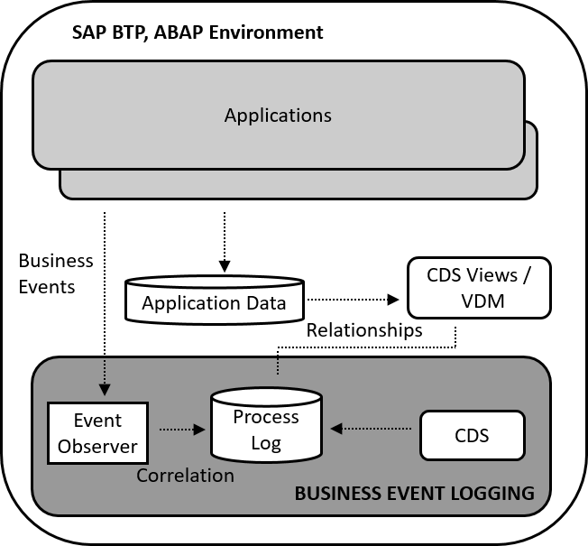

<!-- loiod3fd620a58d74ecc9e89e54aeb79aa95 -->

# Business Event Logging

Business Event Logging enables you to log business events that are raised by activities of SAP S/4HANA applications or business users. Business events are messages that are sent to notify a consumer that an object has changed.

The events triggered during the execution of business activities can be:

-   Business events for remote consumption: C2-released events \(external\)
-   Business events for local consumption: C1-released events \(internal\)

For example, you can find events such as **created**, **changed**, and **deleted** for Sales Order. The RAP-based events are listed in the SAP Business Accelerator Hub.

You can activate Business Event Logging using configuration activities for each object, such as Sales Order, Outbound Delivery, and so on.

The business event logs give you insights into the way processes run in the local system and how objects change. You can get an overview of all the logged business events, the number of events triggered, the types of events triggered, and information on changes to fields. Events of the same type occurring in the same session are grouped into activities.

This graphic displays the components of Business Event Logging:

With Business Event Logging, you can collect records of these business events, irrespective of whether the consumer has subscribed to the event, and relationships between objects to get insights into the way business processes run in the local system.

### Business Events

The entire business data of the event is stored together with additional metadata. For example, the essential properties logged are:

-   Objects

-   Object components

-   Business object key

-   Time stamp of event

-   Event type \(corresponding to performed action\)

-   User who performed the action

-   Field changes contained in the business event

-   Qualifiers \(for generic events\)

-   Transactional information

Field changes are also recorded as long as they are defined in the events.

### Relationships

Relationships show associations between objects. An association can go in two directions:

-   **Outbound** — an association from this object to another object
-   **Inbound** — an association from another object to this object

**Outbound Relationships** 

An outbound relationship originates from the current object and points to a related object. From the perspective of the source object, the related object is the target.

**Inbound Relationships** 

An inbound relationship originates from another object and points to the current object. From the perspective of the target object, the source object is the one establishing the relationship.

**Object-Internal Relationships** 

Relationships can also exist within the same business object — linking two different components of the same object.

> ### Note:  
> Attributes or field changes are recorded only for events available in the [SAP Business Accelerator Hub](https://api.sap.com/products/SAPS4HANACloud/events/events). To record changes for new events, see [Log Custom Business Events](../30-development/log-custom-business-events-6ecc451.md) or contact SAP.

